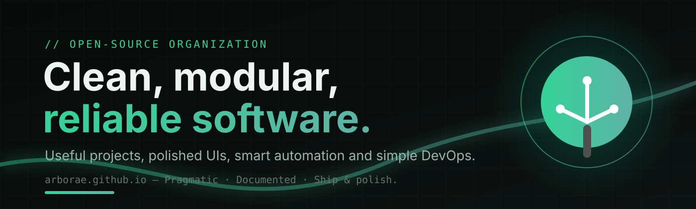

<!--
Arborae — Organization Profile
This README appears on https://github.com/arborae
-->

  

  

<!-- tech stack -->

  

<!-- flagship activity -->

## ⭐ Featured projects

### 🐳 d2ha — Docker to Home Assistant

Know when your containers have updates, read what changed, update them safely and read their logs — in a small web app and in Home Assistant, with native update entities via HACS.

→ [Docs &amp; demo](https://arborae.github.io/docker2homeassistant/) · [Repository](https://github.com/arborae/docker2homeassistant)

### ✋ ESP32-S3 CAM — Gesture recognition

Hand and pinch gesture recognition on an ESP32-S3 camera: Arduino firmware plus a Dockerized Flask server with MediaPipe, MJPEG overlay and MQTT autodiscovery for Home Assistant.

→ [Repository](https://github.com/arborae/ESP32-S3_CAM)

---

## 🧭 Principles

| | |
|:--|:--|
| **01** | **Documentation first** — if it isn't explained well, it isn't done |
| **02** | **Modularity &amp; maintainability** — clear architecture over quick hacks |
| **03** | **Clear UX** — if something is confusing, it's a bug |
| **04** | **Security &amp; transparency** — clear policies, responsible disclosure |

---

## 👥 Who's behind it

Two friends who share a passion for well-made software.

<table>
  <tr>
    <td align="center" width="120">
      
    </td>
    <td>
      <strong>Giovanni</strong> (<a href="https://github.com/giosci1994">@giosci1994</a>) — co-founder · Dev &amp; DevOps 
      <a href="https://giosci1994.github.io">giosci1994.github.io</a>
    </td>
  </tr>
  <tr>
    <td align="center" width="120">
      
    </td>
    <td>
      <strong>Baldo</strong> (<a href="https://github.com/chopin94">@chopin94</a>) — co-founder · Dev
    </td>
  </tr>
</table>

---

## 🤝 Community

- 💬 **Questions, ideas &amp; roadmap** → [Discussions](https://github.com/orgs/arborae/discussions)
- 🐛 **Bugs &amp; feature requests** → Issues, with guided templates, in each repository
- 🔀 **Contributing** → [CONTRIBUTING.md](https://github.com/arborae/.github/blob/main/CONTRIBUTING.md)
- 🔒 **Security** → [SECURITY.md](https://github.com/arborae/.github/blob/main/SECURITY.md)

> Want to help out? Even a small PR is welcome 🌱
